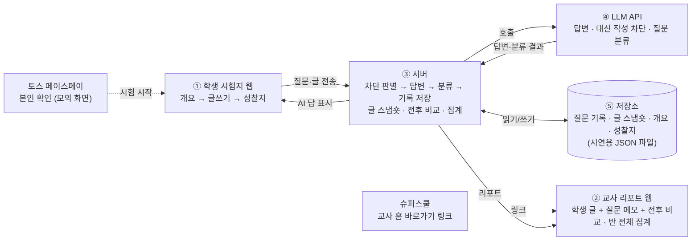

# 01. 프로그램 구성 (아키텍처)

> 한 줄 요약: 화면 2개(학생 시험지·교사 리포트) + 서버 1개 + AI 3가지 역할로 구성되며, 학생 질문 → 서버 → LLM 답변·분류 → 저장 → 교사 리포트 순으로 흐릅니다. (PDF 2장)
>
> 관련 문서: [00-overview](./00-overview.md) · [05-api](./05-api.md) · [07-llm-prompts](./07-llm-prompts.md) · [08-tech-stack](./08-tech-stack.md)

## 구성 요소

만들 프로그램은 **화면 2개 + 서버 1개 + AI 3가지 역할**이다.

| # | 구성 요소 | 역할 | 연결 |
|---|---|---|---|
| ① | 학생 시험지 웹 | 개요 → 글쓰기 → 성찰지, 질문과 도토리 사용 | 질문·글을 서버로 보냄 |
| ② | 교사 리포트 웹 | 학생 글 + 질문 메모 + 전후 비교, 반 전체 집계 | 서버에서 리포트를 받아 옴 |
| ③ | 서버 | 질문 받기 → 차단 판별 → 답변 → 분류 → 기록 저장, 글 스냅숏·전후 비교·집계 | LLM API, 저장소와 연결 |
| ④ | LLM API | 답변(🔄 PDF는 3문장, 지금은 길이 제한 없음), 대신 작성 차단, 질문 분류 | 서버가 호출 |
| ⑤ | 저장소 | 질문 기록, 글 스냅숏, 개요, 성찰지 | 시연용은 JSON 파일 |
| — | 슈퍼스쿨 | 교사 홈 바로가기 링크로 ② 연결 | 링크 추가 (API는 확장) |
| — | 토스 페이스페이 | 시험 시작 본인 확인 | 모의 화면 |

### AI 3가지 역할

PDF 2장 표의 ④ LLM API 역할 "답변, 대신 작성 차단, 질문 분류" 3가지를 지금 코드에서는 이렇게 처리한다.

| 역할 | 처리 | 우선순위 |
|---|---|---|
| 답변 | 답변 AI (🔄 길이 제한 없음) | P0 |
| 대신 작성 차단 | 답변 AI의 `[BLOCKED]` **또는** 분류 결과 "대신 작성 요청" | P0 |
| 질문 분류 | 분류 AI (답변과 동시에 호출) | P1 |
| (작성 경로 판정) | 🔄 LLM을 쓰지 않고 서버에서 문장 유사도로 계산 | P1 |

자세한 내용: [07-llm-prompts](./07-llm-prompts.md)

### 지금 코드의 위치

| 구성 요소 | 위치 |
|---|---|
| ③ 서버 | Next.js API Route `src/app/api/**` |
| ④ LLM API | `src/lib/llm.ts` (BAZE API Gateway), `src/lib/tutor.ts` (답변·차단·분류) |
| ⑤ 저장소 | `src/lib/store.ts` → `data/attempts/<학생ID>.json` |
| 리포트 계산 | `src/lib/report.ts` (전후 비교, 작성 경로, 반 집계) |
| 시험 설정 | `src/lib/exam-config.ts` |
| ①② 화면 | 아직 없음 |

## 데이터 흐름

PDF 원문 흐름: **학생 질문 → 서버 → LLM 답변·분류 → 저장 → 교사 리포트**

## 노출 범위

- 메모·분류·작성 경로는 **교사 리포트에만** 보인다. 학생 화면에는 보이지 않는다. ([02-student-screens](./02-student-screens.md))
