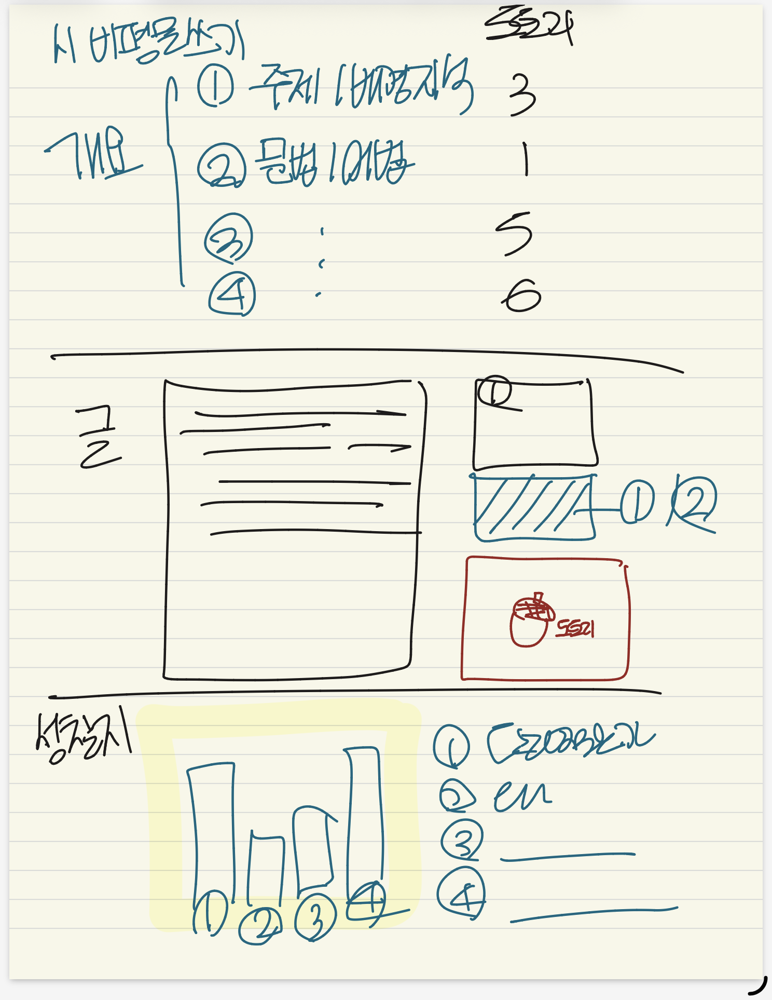
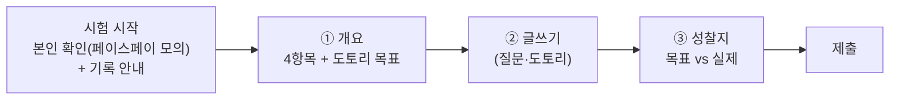

# 02. 학생 시험지 화면

> 한 줄 요약: 학생 시험지는 시험 시작(본인 확인 모의 + 기록 안내) 후 ①개요(4항목 + 도토리 목표) → ②글쓰기 → ③성찰지 3단계로 진행되며, 메모·분류·작성 경로는 학생에게 보이지 않습니다. (PDF 3장 + 팀 결정 반영)
>
> 관련 문서: [03-teacher-report](./03-teacher-report.md) · [04-features](./04-features.md) · [05-api](./05-api.md) · [API.md](./API.md) · [10-assessment-design](./10-assessment-design.md)

## 손그림 화면 틀

- 출처: PDF 2쪽 "손그림 (기본 틀)" 이미지를 그대로 추출.
- 그림 구성(위→아래): **시 비평문 쓰기** 제목 / **개요** ①~④와 오른쪽 "도토리" 열(예: 3, 1, 5, 6) / **글** 왼쪽 큰 글쓰기 창 + 오른쪽 위 입력 상자 ①, 가운데 빗금 상자(①② 표시), 아래 빨간 상자 안 도토리 그림 / **성찰지** 왼쪽 막대그래프 ①~④ + 오른쪽 ①~④ 입력줄
- 그림 속 도토리 숫자(3, 1, 5, 6)는 예시. 지금 설계에서는 이 열에 항목별 `사용 / 목표`를 보여 준다.
- 디자인 시안: 캔버스 「도토리 시험지 · 학생 화면」, 「전체 틀」 참고 (PDF 8장). 시안 위치/링크: TBD(확인 필요)

## 전체 흐름

| 단계 | 호출 API |
|---|---|
| 시험 시작 | `POST /api/exam/start` |
| ① 개요 | `POST /api/outline` |
| ② 글쓰기 | `POST /api/draft` (10초마다), `POST /api/ask` |
| ③ 성찰지 | `GET /api/attempt/:attemptId`, `POST /api/draft` → `POST /api/submit` |
| 새로고침 | `GET /api/attempt/:attemptId` (상태 복원) |

## 0. 시험 시작 화면

| 화면 요소 | 동작 |
|---|---|
| 응시자 본인 확인 (토스 페이스페이 **모의** 화면) | 확인 후 `POST /api/exam/start` (`verified: true`). 같은 학생이 다시 시작하면 기존 응시를 이어서 함 |
| 안내 문구 | **"질문과 글쓰기 과정은 기록되어 선생님께만 전달됩니다"** |

- 본인 확인 모의 화면의 구체적인 UI: TBD(확인 필요)
- 페이스페이 실연동은 P2. 사용 여부 자체는 멘토 확인 필요 ([11-decisions-schedule](./11-decisions-schedule.md))

## ① 개요

| 화면 요소 | 동작 |
|---|---|
| 개요 4항목 입력칸: **주제·배경지식 / 문법·어휘 / 해석과 근거 / 비평과 고쳐쓰기** | 개요 입력·저장 (`POST /api/outline`) |
| 🔄 항목별 **도토리 목표** 입력 (0~10) | "이 항목에 몇 개 쓸지" 학생이 스스로 정함. 시험이 총개수를 정하지 않음 |
| 항목별 도토리 수 표시 | 2단계에서 질문할 때 자동으로 쌓임. `사용 3 / 목표 2`처럼 숫자로 표시 |

- 10장 운영 설계상 개요는 1차시에 **AI 없이** 작성한다.
- 개요·목표를 내지 않으면 질문할 수 없다 (409 "개요와 도토리 계획을 먼저 작성해 주세요.").
- 첫 질문 전까지는 다시 고칠 수 있고, **첫 질문 이후에는 목표가 잠긴다.**
- 목표 최대값(10)은 `exam/start` 응답의 `exam.acornPlanMaxPerItem`을 쓴다 (화면에 숫자를 직접 쓰지 않음).

## ② 글쓰기

| 위치 | 화면 요소 |
|---|---|
| 왼쪽 | 글쓰기 창 (10초마다 자동 저장) |
| 오른쪽 위 | 질문 쓰기 |
| 가운데 | 나의 질문 기록 ①② |
| 아래 | 도토리 창고 |

### 질문 동작 순서

1. 학생이 글쓰기 창에서 **글을 드래그**(선택)한다. (드래그 없이도 질문 가능)
2. 질문을 쓰고, **어느 개요 항목에 대한 질문인지 고른다 (①~④)** → 1단계 표와 3단계 그래프에 반영
3. 확인창: **"도토리 1개를 사용할까요?"** — 목표를 넘겼어도 같은 확인창 하나만, 추가 경고 없음
4. `POST /api/ask` 호출 (선택한 글, 선택 위치, 현재 글 전체를 함께 보냄)
5. 사용되면 → 창고의 **도토리가 넘어짐** (애니메이션)
6. **AI 답 표시** (🔄 길이 제한 없음)

| 상황 | 응답 | 화면 동작 |
|---|---|---|
| 일반 질문 | `charged: true` | 도토리 1개 차감, 넘어지는 효과, AI 답 표시 |
| 목표보다 많이 씀 | `charged: true`, `overPlan: true` | 평소와 똑같이 처리. `사용 / 목표` 숫자만 바뀜 (경고 없음) |
| 대신 작성 요청 (차단) | `blocked: true`, `charged: false` | 되묻기 문구 표시, **도토리 그대로** (넘어지지 않음) |
| 안전 상한(30번) 도달 | HTTP 429 | "이번 시험에서 질문할 수 있는 횟수를 모두 썼어요." 표시 |

- 차단 시 표시 문구: "이 시험에서는 글을 대신 써 줄 수 없어요. 어느 부분에서 막혔는지 알려 주세요."
- 차단된 질문도 "나의 질문 기록"에 남는다 (`acornNo: null`, `blocked: true`).
- 안전 상한은 학생에게 미리 보여 주지 않는다.
- "넘어지는" 애니메이션 상세 모양: TBD(확인 필요)

## ③ 성찰지

| 위치 | 화면 요소 | 동작 |
|---|---|---|
| 왼쪽 | 🔄 개요 항목별 **목표 vs 실제** 도토리 막대그래프 | `GET /api/attempt/:attemptId`의 `acornPlan`, `acornsUsed`로 자동 생성 |
| 오른쪽 | 성찰 질문 ①~④ 입력칸 | 답 입력 후 제출 (`POST /api/draft` → `POST /api/submit`) |

성찰 질문 (10장):

1. 도토리를 가장 많이 쓴 항목과 이유
2. 가장 도움이 된 질문
3. AI 답을 받고 글이 어떻게 달라졌나
4. 다음엔 도토리를 어떻게 쓰고 싶나

- 제출 후에는 질문과 글 저장이 막힌다.

## 학생에게 보이지 않는 정보

> **학생 화면에는 메모·분류·작성 경로가 보이지 않는다.**

| 정보 | 학생 화면 | 교사 리포트 |
|---|---|---|
| 여백 메모 (도토리 번호·시간·질문·분류) | ❌ | ✅ |
| 질문 분류 (쓰기 단계 × 질문 방식) | ❌ | ✅ |
| 작성 경로 (스스로 작성 / 질문 후 수정 / AI 답변 활용) | ❌ | ✅ |
| 질문 전후 비교 | ❌ | ✅ |
| 안전 상한 (30번) | ❌ | — |

- 학생용 API(`/api/attempt/:attemptId`, `/api/ask`) 응답에는 이 값들이 처음부터 들어 있지 않다.
- 학생이 볼 수 있는 것: 자기 글, 자기 질문과 AI 답(나의 질문 기록), 도토리 창고, 항목별 목표·사용 수와 그래프.
