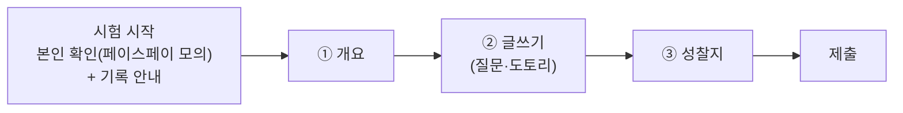

# 02. 학생 시험지 화면

> 한 줄 요약: 학생 시험지는 시험 시작(본인 확인 모의 + 기록 안내) 후 ①개요 → ②글쓰기 → ③성찰지 3단계로 진행되며, 메모·분류·작성 경로는 학생에게 보이지 않습니다. (PDF 3장)
>
> 관련 문서: [03-teacher-report](./03-teacher-report.md) · [04-features](./04-features.md) · [05-api](./05-api.md) · [10-assessment-design](./10-assessment-design.md)

## 손그림 화면 틀

- 출처: PDF 2쪽 "손그림 (기본 틀)" 이미지를 그대로 추출.
- 그림 구성(위→아래): **시 비평문 쓰기** 제목 / **개요** ①~④와 오른쪽 "도토리" 열(예: 3, 1, 5, 6) / **글** 왼쪽 큰 글쓰기 창 + 오른쪽 위 입력 상자 ①, 가운데 빗금 상자(①② 표시), 아래 빨간 상자 안 도토리 그림 / **성찰지** 왼쪽 막대그래프 ①~④ + 오른쪽 ①~④ 입력줄
- 그림 속 숫자(3, 1, 5, 6)는 예시로 보임. 실제 값 의미: TBD(확인 필요)
- 디자인 시안: 캔버스 「도토리 시험지 · 학생 화면」, 「전체 틀」 참고 (PDF 8장). 시안 위치/링크: TBD(확인 필요)

## 전체 흐름

## 0. 시험 시작 화면

| 화면 요소 | 동작 |
|---|---|
| 응시자 본인 확인 (토스 페이스페이 **모의** 화면) | 본인 확인 후 시험 시작. 서버 `POST /exam/start`에서 본인 확인 기록 |
| 안내 문구 | **"질문과 글쓰기 과정은 기록되어 선생님께만 전달됩니다"** |

- 본인 확인 모의 화면의 구체적인 UI: TBD(확인 필요)
- 페이스페이 실연동은 P2 (발표에서 설명만). 사용 여부 자체는 멘토 확인 필요 ([11-decisions-schedule](./11-decisions-schedule.md))

## ① 개요

| 화면 요소 | 동작 |
|---|---|
| 개요 4항목 입력칸: **주제·배경지식 / 문법·어휘 / 해석과 근거 / 비평과 고쳐쓰기** | 개요 입력·저장 (`POST /outline`) |
| 항목별 도토리 수 표시 | 도토리 수는 2단계에서 질문할 때 **자동으로 쌓임** |

- 10장 운영 설계상 개요는 1차시에 **AI 없이** 작성한다.

## ② 글쓰기

| 위치 | 화면 요소 |
|---|---|
| 왼쪽 | 글쓰기 창 |
| 오른쪽 위 | 질문 쓰기 |
| 가운데 | 나의 질문 기록 ①② |
| 아래 | 도토리 창고 |

### 질문 동작 순서

1. 학생이 글쓰기 창에서 **글을 드래그**(선택)한다.
2. 질문을 쓰고, **어느 개요 항목에 대한 질문인지 고른다 (①~④)** → 1단계 표와 3단계 그래프에 반영
3. 확인창: **"도토리 1개를 사용할까요?"**
4. 사용하면 → 창고의 **도토리가 넘어짐** (애니메이션)
5. **AI 답 표시** (3문장 이내)

| 상황 | 화면 동작 |
|---|---|
| 일반 질문 | 도토리 1개 차감, 넘어지는 효과, AI 답 표시 |
| 대신 작성 요청 (차단) | 답 대신 되묻기 문구 표시, **도토리 차감 없음** (도토리 그대로) |

- 차단 시 표시 문구 (7장 ① 원문): "이 시험에서는 글을 대신 써 줄 수 없어요. 어느 부분에서 막혔는지 알려 주세요."
- 선택한 글의 위치는 텍스트의 시작·끝 위치로 저장 (8장)
- 차단 시 "사용할까요?" 확인창을 거친 뒤 차단을 알리는지, 차단 질문도 "나의 질문 기록"에 표시하는지: TBD(확인 필요)
- 도토리 총개수(창고 초기값)와 0개일 때 동작: TBD(확인 필요) — 상한은 11장 남은 결정
- "넘어지는" 애니메이션 상세 모양: TBD(확인 필요)
- 글 자동 저장 주기 (`POST /draft` 호출 시점): TBD(확인 필요)

## ③ 성찰지

| 위치 | 화면 요소 | 동작 |
|---|---|---|
| 왼쪽 | 개요 항목별 도토리 **막대그래프** | 자동 생성 |
| 오른쪽 | 성찰 질문 ①~④ 입력칸 | 답 입력 후 제출 (`POST /submit`) |

성찰 질문 (10장):

1. 도토리를 가장 많이 쓴 항목과 이유
2. 가장 도움이 된 질문
3. AI 답을 받고 글이 어떻게 달라졌나
4. 다음엔 도토리를 어떻게 쓰고 싶나

## 학생에게 보이지 않는 정보

> **학생 화면에는 메모·분류·작성 경로가 보이지 않는다.**

| 정보 | 학생 화면 | 교사 리포트 |
|---|---|---|
| 여백 메모 (도토리 번호·시간·질문·분류) | ❌ | ✅ |
| 질문 분류 (쓰기 단계 × 질문 방식) | ❌ | ✅ |
| 작성 경로 (스스로 작성 / 질문 후 수정 / AI 답변 활용) | ❌ | ✅ |
| 질문 전후 비교 | ❌ | ✅ |

- 구현 시 API 응답에서도 학생용 응답에 위 필드를 포함하지 않도록 한다.
- 학생이 볼 수 있는 것: 자기 글, 자기 질문과 AI 답(나의 질문 기록), 도토리 창고, 개요 항목별 도토리 수/그래프.
